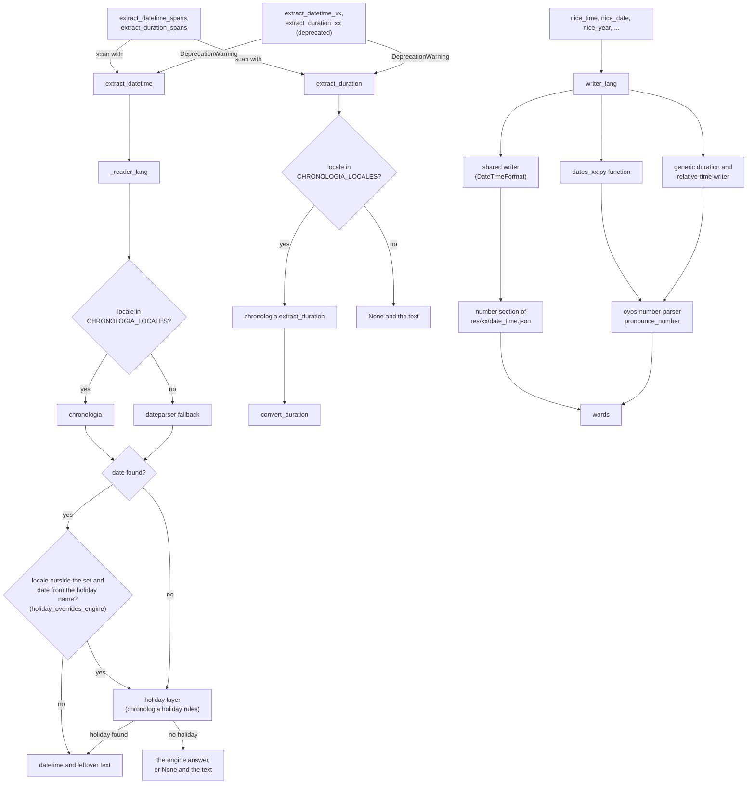

# How it works

<!-- agent-hint
covers: which calls are shims over chronologia, which code writes each language, and the path of a call through the package
source: ovos_date_parser/__init__.py (extract_datetime, extract_duration, nice_time, _reader_lang), ovos_date_parser/common.py:writer_lang, ovos_date_parser/holidays.py
generated: no
verify: diff <(.venv/bin/python -I docs/plots/writer_coverage.py --table | awk -F'\t' 'NR==1 || $1=="an" || $1=="bs" || $1=="id"' | tr '\t' '|') <(sed -n '/^\x60\x60\x60text/,/^\x60\x60\x60$/p' docs/how-it-works.md | sed -e 1d -e '$d') && .venv/bin/python -I docs/plots/writer_coverage.py --table | awk -F'\t' 'NR>1 {rows++; if ($2 == "missing") bad++; for (i = 2; i <= 10; i++) if ($i == "missing") gaps++} END {exit !(rows == 40 && bad == 0 && gaps == 10)}'
see: api.md, writers.md, languages.md, getting-started.md
-->

This page shows what happens inside the package when you call a public
function. It tells you which calls pass the work to chronologia and which code
in this repository writes each language.

## Two halves

The package has a reading half and a writing half.

The reading half turns text into values. It is a thin layer over
[chronologia](https://github.com/TigreGotico/chronologia).
`extract_datetime` and `extract_duration` normalize the language tag and call
chronologia for each of the 61 locales in `CHRONOLOGIA_LOCALES`. The layer adds
the `datetime` shape of the answer, the leftover text, the `default_time`,
`resolution` and `replace_token` options, and the span scans
`extract_datetime_spans` and `extract_duration_spans`. This package holds no
reading grammar for those locales. A locale outside the set goes to
[dateparser](https://dateparser.readthedocs.io), with a small reader for
Japanese weekdays and one for unspaced Chinese.

The writing half turns values into words. This package owns it. It writes 40
languages: each has a module `dates_<code>.py`, a folder `res/<code>/` of
JSON data, or both. The `nice_*` functions pick the writer by language code, and
the data and the code split the number words. The shared writer for dates,
days and years takes its number words from the `number` section of
`res/<code>/date_time.json`. The language modules, the generic duration writer
and the generic relative-time writer call
[ovos-number-parser](https://github.com/OpenVoiceOS/ovos-number-parser).

The top-level functions are the stable API. The modules `astrodate`,
`calendars`, `cycles`, `eras`, `regnal` and `roman` re-export chronologia names
at their old import paths. The names `extract_datetime_<code>` and
`extract_duration_<code>` are deprecated shims over the two reading functions.

## The path of a call



Read the diagram from the box at the top of each group. A reading call goes to
chronologia for the locales in the set. When the reader finds no date, the
holiday layer asks chronologia for a named holiday such as "christmas". If it
finds none, the answer is `None` and the text. For a locale outside the set,
the layer also takes over when dateparser read a date from the holiday name
itself, such as "friday" in "good friday". If the layer then finds no holiday,
the answer of dateparser stands. A writing call finds the writer language with `writer_lang`.
It then calls a function in the language module, the shared writer that reads
`res/<code>/`, or the generic duration and relative-time writer. The shared
writer says numbers with the words in the data. The other two call
ovos-number-parser.

## Which calls pass the work to chronologia

| Call | Path | Outside `CHRONOLOGIA_LOCALES` |
|---|---|---|
| `extract_datetime` | chronologia | dateparser, then the holiday layer |
| `extract_duration` | chronologia | answers `(None, text)` |
| `extract_datetime_spans`, `extract_duration_spans` | repeated calls of the two functions above | the same fallbacks |
| `holidays.extract_holiday_span`, `holidays.extract_holiday_date` | chronologia holiday rules | the same rules, for the holiday names of the language |
| `extract_timespan`, `explain`, `AstroDate`, `DateSpan` | re-exported chronologia names | not applicable |
| `extract_datetime_<code>`, `extract_duration_<code>` | deprecated shims over the two reading functions | not defined |

[languages.md](languages.md#languages-that-read) lists the 61 locales.
[api.md](api.md#deprecated-reader-names) lists the deprecated names.

## Which code writes each language

All 40 writer languages have a `nice_time`. Some also have their own functions
for the date, the day, the weekday, the month and the year, and a few have a
duration writer of their own. The other functions read word lists and format
strings from `res/<code>/date_time.json` and `res/<code>/date_words.json`.


The plot shows, for each language and function, whether the language module
defines `nice_*_<code>`, whether the shared writer answers from `res/`, or
whether the call raises `NotImplementedError`. Read it for the gaps. Aragonese
and Western Frisian have no duration or relative-time writer. Indonesian and
Malay have no date, date-time or year writer. Bosnian has no module, and its
`nice_time` is the Croatian module function.

The table behind the plot has one row per language. A cell says `module`,
`shared` or `missing`. These rows show Aragonese, Bosnian and Indonesian:

```text
language|nice_time|nice_date|nice_date_time|nice_day|nice_weekday|nice_month|nice_year|nice_duration|nice_relative_time
an|module|module|module|module|module|module|module|missing|missing
bs|module|shared|shared|shared|shared|shared|shared|shared|shared
id|module|missing|missing|shared|shared|shared|missing|shared|shared
```

Rebuild the plot from the repository root with
`.venv/bin/python docs/plots/writer_coverage.py`. The script needs matplotlib.
It runs in a few seconds and prints the table behind the plot. The flag
`--table` prints the table and writes no image.

[writers.md](writers.md) names the functions of each language.

---
[Index](index.md) · [← Adding a language](adding-a-language.md) · [API reference →](api.md)
